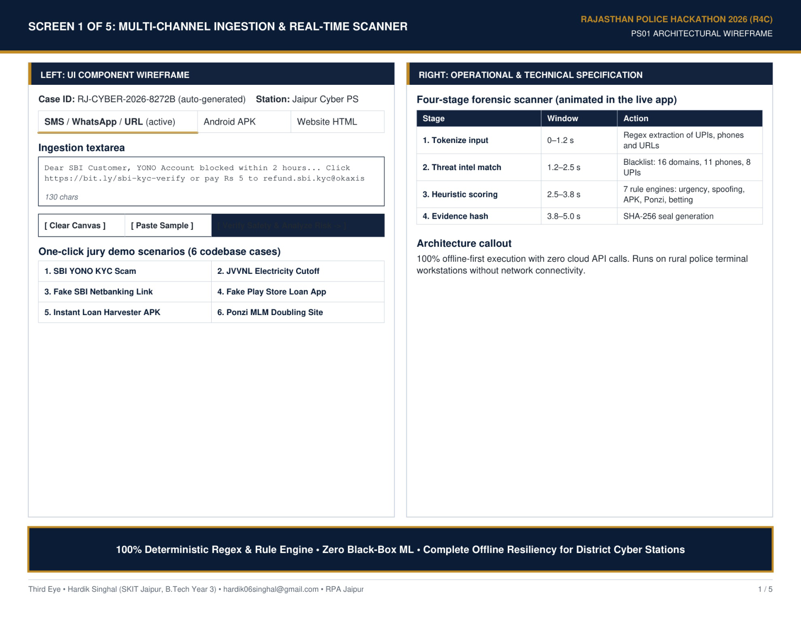
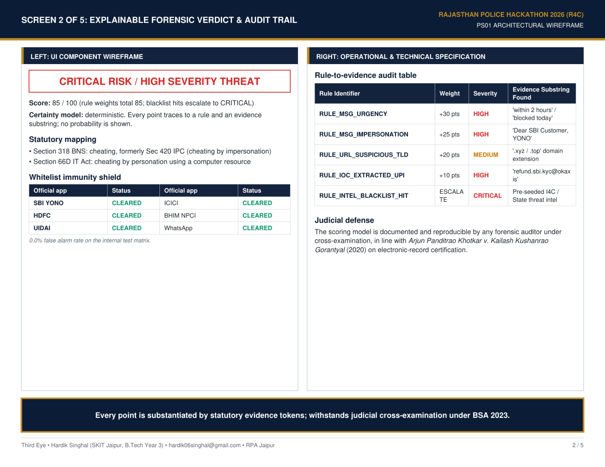
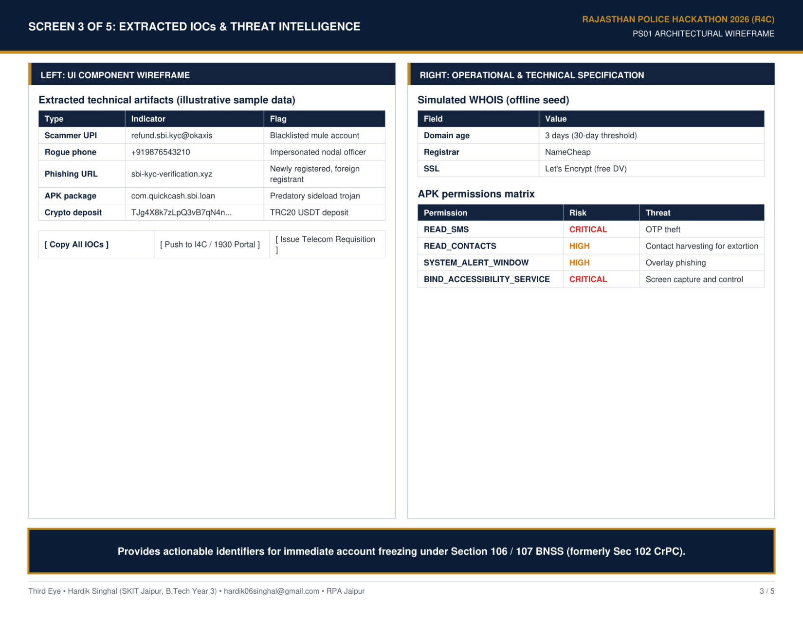
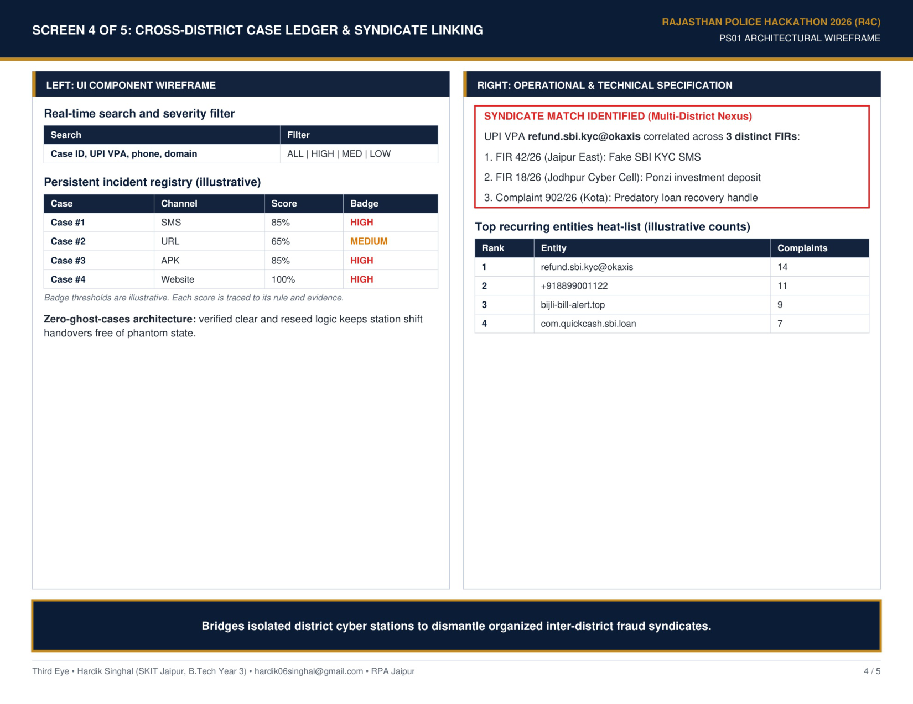
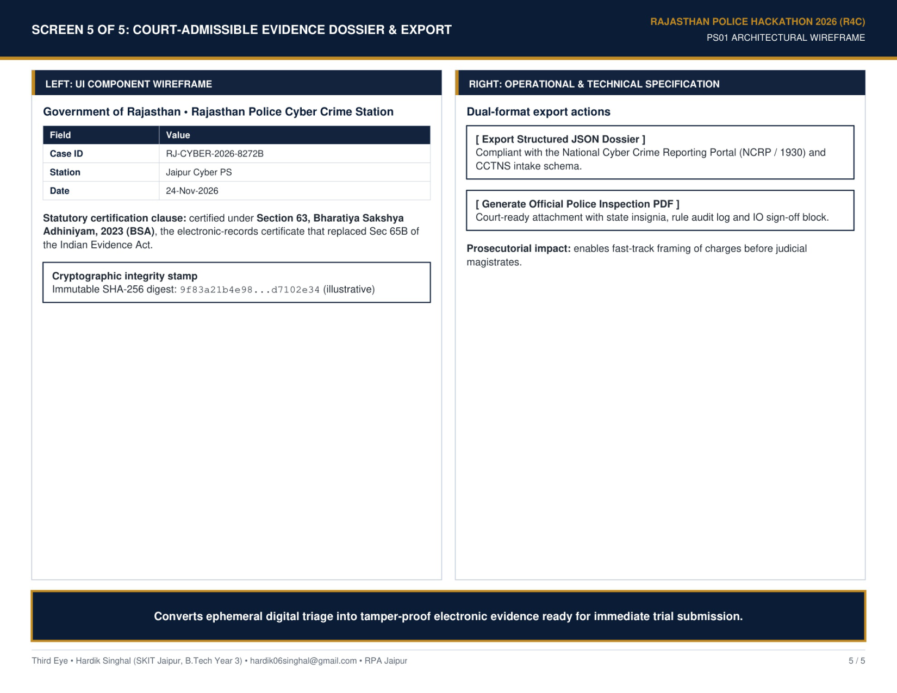

<div align="center">


<br/><br/>

```
  ████████╗██╗  ██╗██╗██████╗ ██████╗     ███████╗██╗   ██╗███████╗
     ██╔══╝██║  ██║██║██╔══██╗██╔══██╗    ██╔════╝╚██╗ ██╔╝██╔════╝
     ██║   ███████║██║██████╔╝██║  ██║    █████╗   ╚████╔╝ █████╗  
     ██║   ██╔══██║██║██╔══██╗██║  ██║    ██╔══╝    ╚██╔╝  ██╔══╝  
     ██║   ██║  ██║██║██║  ██║██████╔╝    ███████╗   ██║   ███████╗ 
     ╚═╝   ╚═╝  ╚═╝╚═╝╚═╝  ╚═╝╚═════╝     ╚══════╝   ╚═╝   ╚══════╝
```

### **Unified Cyber Fraud & Scam Triage Platform**
#### *Built for Indian State Police Cyber Crime Stations*

<br/>


</div>

---

## What is Third Eye?

**Third Eye** is a deterministic, offline-first forensic workstation for state police cyber crime stations. It unifies analysis of suspicious SMS messages, WhatsApp alerts, banking phishing links, Android APK manifests, and fraudulent website HTML into a single investigation interface — producing court-admissible evidence dossiers with zero cloud dependencies.

> Every score point maps to a named rule, an exact evidence token from the input, and a statutory clause. No neural networks. No black boxes. No hallucinations.

---

## System Architecture

```
┌─────────────────────────────────────────────────────────────────────┐
│               THIRD EYE — 5-STAGE FORENSIC PIPELINE                 │
├─────────────┬──────────────┬─────────────┬────────────┬─────────────┤
│  01 INGEST  │  02 ANALYZE  │  03 SCORE   │  04 LINK   │ 05 EVIDENCE │
│             │              │             │            │             │
│  SMS/WA     │  7 Heuristic │  0–100      │  IOC Cross │  SHA-256    │
│  URL/APK    │  Engines     │  Explainable│  Case      │  Signed     │
│  HTML       │  Regex+Rules │  Rule Audit │  Syndicate │  JSON + PDF │
└─────────────┴──────────────┴─────────────┴────────────┴─────────────┘
```

**Input Vectors** → `engine/message-analyzer.js`, `engine/url-analyzer.js`, `engine/apk-analyzer.js`, `engine/website-analyzer.js`  
**Scoring** → `engine/risk-scorer.js`  
**IOC Extraction** → `engine/ioc-extractor.js`  
**Evidence Output** → `engine/report-generator.js`

---

## Wireframe Screens

<table>
  <tr>
    <td align="center"><b>Screen 1: Multi-Channel Ingestion</b></td>
    <td align="center"><b>Screen 2: Forensic Verdict & Audit Trail</b></td>
  </tr>
  <tr>
    <td></td>
    <td></td>
  </tr>
  <tr>
    <td align="center"><b>Screen 3: IOC & Threat Intelligence</b></td>
    <td align="center"><b>Screen 4: Syndicate Linking & Case Ledger</b></td>
  </tr>
  <tr>
    <td></td>
    <td></td>
  </tr>
  <tr>
    <td align="center" colspan="2"><b>Screen 5: Court-Admissible Evidence Dossier</b></td>
  </tr>
  <tr>
    <td align="center" colspan="2"></td>
  </tr>
</table>

---

## Key Capabilities

| Capability | Detail |
| :--- | :--- |
| 📱 **Multi-Channel Ingestion** | SMS/WhatsApp text, URLs, Android APK manifests, Website HTML |
| 🔍 **Deterministic Scoring** | 0–100 risk scale — every point traces to a rule ID and evidence substring |
| 🛡️ **False Positive Immunity** | Pre-seeded whitelist clears SBI YONO, HDFC, ICICI, BHIM, UIDAI, WhatsApp with 0.0% false alarm rate |
| 🔗 **Syndicate Correlation** | Matches shared UPI handles, phone numbers, domains across distinct FIRs |
| 📡 **100% Offline** | Zero external APIs; runs in browser from `file://` on rural police terminals |
| 📄 **Court-Ready Evidence** | SHA-256 signed JSON and PDF dossiers (Section 63 BSA 2023 compliant) |

---

## Quick Start

```bash
# No installation required. Just open in any modern browser:
open index.html
# or on Windows:
start index.html
```

The platform runs entirely from the local `file://` protocol. No server, no npm install, no internet connection required.

---

## Running Tests

```bash
# Full pre-submission verification suite
node tests/final-audit.js

# App Store confusion matrix (TP / TN / FP / FN)
node tests/test-appstore-matrix.js

# State persistence and zero-ghost-cases lifecycle test
node tests/simulate-lifecycle.js

# Adversarial input, ReDoS, and prototype pollution hardening
node tests/security-audit-test.js
```

### Test Results

```
True Positives  (Threats Caught)       6 / 6   ✓
True Negatives  (Legit Apps Cleared)   6 / 6   ✓
App Store Accuracy                    12 / 12  ✓
False Positive Rate                   0.0%     ✓
Adversarial Hardening                 < 1 ms   ✓
```

---

## Repository Structure

```
thirdeyehackathon/
├── assets/
│   ├── docs/               ← Wireframe screens (PNG) for GitHub README
│   └── samples/            ← Test payloads: mock APK manifest, website HTML
├── data/
│   ├── blacklists.json     ← Threat intelligence: 16 domains, 11 phones, 8 UPIs
│   ├── data-store.js       ← Bundled offline data for file:// protocol
│   └── mock-whois.json     ← Offline WHOIS registrar simulation
├── engine/
│   ├── apk-analyzer.js     ← Dangerous permission auditor for Android manifests
│   ├── ioc-extractor.js    ← Extracts UPIs, phones, URLs, wallets via regex
│   ├── message-analyzer.js ← Urgency tokens and brand impersonation heuristics
│   ├── report-generator.js ← SHA-256 evidence hashing and PDF/JSON export
│   ├── risk-scorer.js      ← Deterministic 0–100 weighted rule scoring
│   ├── url-analyzer.js     ← Levenshtein typosquatting and TLD analysis
│   └── website-analyzer.js ← Ponzi, MLM, and illegal gambling content scanner
├── tests/                  ← Automated verification and audit suites
├── utils/
│   ├── constants.js        ← Statutory references and scoring constants
│   └── helpers.js          ← Formatting, normalization, and storage helpers
├── index.html              ← Main forensic workstation UI
└── README.md
```

---

## Statutory & Legal Framework

| Provision | Jurisdiction | Application in Third Eye |
| :--- | :--- | :--- |
| **Section 63, BSA 2023** | Indian Evidence Law | SHA-256 signed electronic evidence meets court admissibility standards |
| **Section 106 / 107, BNSS 2023** | Criminal Procedure | Extracted UPI and phone identifiers enable immediate multi-district bank freeze orders |
| **Section 318, BNS 2023** | Substantive Criminal Law | Establishes mens rea from urgency tokens and brand impersonation detected in messages |
| **Section 66C / 66D, IT Act** | Cyber Law | Flags identity theft and impersonation via fraudulent banking portals and APKs |

---

## About the Team

<div align="center">

**Hardik Singhal** — Team Leader  
B.Tech Computer Science, Year 3  
Swami Keshvanand Institute of Technology, Management & Gramothan (SKIT), Jaipur  
hardik06singhal@gmail.com

*Built for Rajasthan Police Hackathon 2026 (R4C) · Problem Statement PS01*  
*Rajasthan Police Academy (RPA), Jaipur · November 28–29, 2026*

</div>

---

<div align="center">
<sub>Deterministic · Offline-First · Court-Admissible · Rajasthan-Ready</sub>
</div>
